# CLOSING TIME — storyboard (v1)

35 shots · about 9 minutes · 2.39:1 widescreen · zombie survival

The pictures set framing, staging and camera. 20 shots are rendered in real 3D with three.js (2D characters inside 3D sets); the close-up inserts are flat drawings. The final 3D art is made from the **image prompt** on each shot (every prompt ends with the style line below).

**Style line (add to every prompt):** Cinematic 3D animated film still, stylised cartoon characters with solid black skin, big round white eyes and simple bold clothes (match the character references), detailed realistic 3D environment, volumetric fog, moody cinematic lighting, anamorphic 2.39:1 frame, shallow depth of field, subtle film grain, no text, no logos.

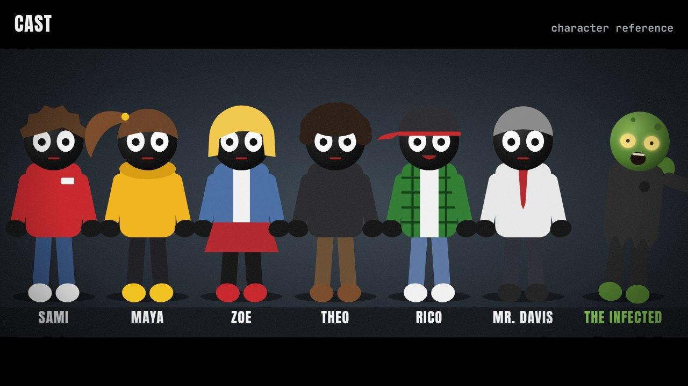

## Music cues (to be composed in Python)

| Cue | Title | Time | Feel |
|---|---|---|---|
| M1 | Closing Time (store muzak) | 0:00–0:42 | Bland, cheerful store music. On shot 5 it warps, slows down and dies. |
| M2 | The Turn | 0:42–2:30 | Low drone and pulses, sharp hits on the shutter and the freezer. Cuts out under Mum's call. |
| M3 | Alone | 2:30–3:55 | Lonely ticking piano: Sami's theme. Warm but empty. |
| M4 | The Knock | 3:55–4:35 | Heartbeat, rising strings, a slam into silence. |
| M5 | Five | 4:35–5:00 | Sami's theme, warmer, with a second voice joining. |
| M6 | The Air | 5:00–6:40 | The generator drone becomes the music. Detuned, sick, with a digital tick for the countdown. Silence, then a sub hit on the freezer. |
| M7 | Grief | 6:40–7:40 | Sami's theme, one hand only, slow. |
| M8 | Theo's Song (on screen) | 7:40–8:20 | A cheerful pop loop played from Theo's speaker, under a rising orchestral drone. |
| M9 | Plan B (escape theme) | 8:20–9:05 | The full theme: drums, strings, piano, big and hopeful. Ends on one held note. |

## Shots

### 1. Day 1 · Register 2 — 0:00–0:06

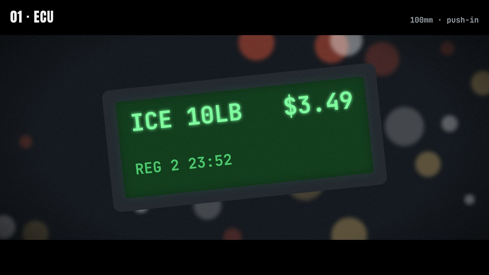

- **Shot:** ECU · insert · **Lens:** 100mm macro
- **Camera:** Slow push-in on the till screen; focus pulls from the price to the glowing time.
- **Action:** Till screen: ICE 10LB — $3.49. REG 2. 23:52.
- **Sound:** NARRATOR: "The last thing you ever sell is a bag of ice."  SFX: till beep, fridge hum. MUSIC: bland store muzak, slightly detuned.
- **Image prompt:** Extreme close-up of a supermarket till display glowing green, showing an item line and a price, shallow depth of field, out-of-focus store lights behind, late night. Cinematic 3D animated film still, stylised cartoon characters with solid black skin, big round white eyes and simple bold clothes (match the character references), detailed realistic 3D environment, volumetric fog, moody cinematic lighting, anamorphic 2.39:1 frame, shallow depth of field, subtle film grain, no text, no logos.

### 2. Day 1 · Register 2 — 0:06–0:16

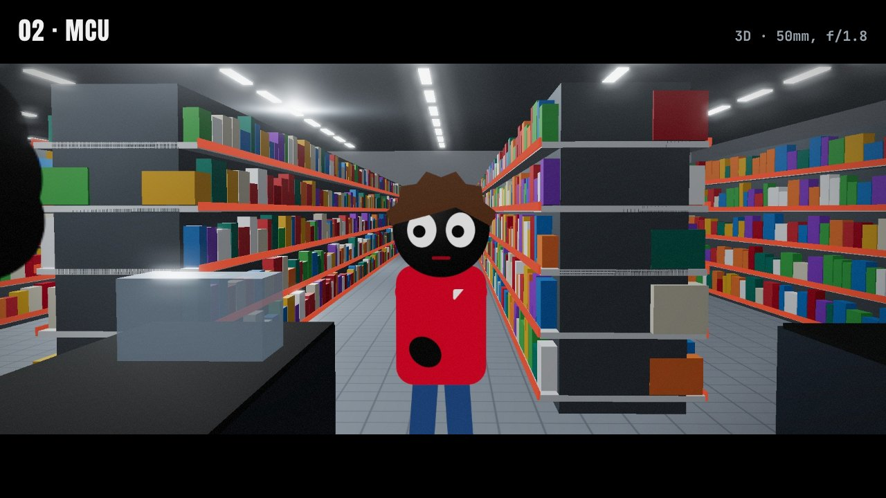

- **Shot:** MCU · over-the-shoulder · **Lens:** 50mm, f/1.8
- **Camera:** Locked off; a slow 5% push. The man's shoulder stays soft in the foreground.
- **Action:** Sami at the till, name badge on, scanning a bag of ice. The man's wet, dark shoulder fills the left of frame; his sleeve is pulled over his hand.
- **Sound:** NARRATOR: "Three forty-nine. Register two. Eleven fifty-two p.m."
- **Image prompt:** Over-the-shoulder shot from behind a man in a wet dark jacket (soft focus foreground) toward a teenage cashier in a red T-shirt and name badge (REF Sami) behind a supermarket checkout, a bag of ice on the belt, bright fluorescent store behind. Cinematic 3D animated film still, stylised cartoon characters with solid black skin, big round white eyes and simple bold clothes (match the character references), detailed realistic 3D environment, volumetric fog, moody cinematic lighting, anamorphic 2.39:1 frame, shallow depth of field, subtle film grain, no text, no logos.

### 3. Day 1 · Register 2 — 0:16–0:22

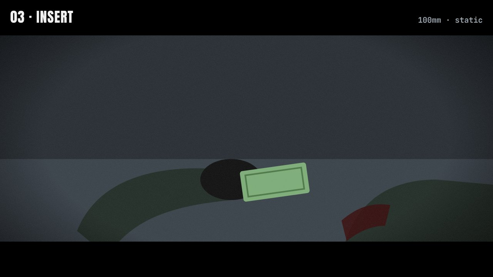

- **Shot:** Insert · ECU · **Lens:** 100mm macro
- **Camera:** Static; the hand trembles in frame.
- **Action:** His left hand pushes crumpled cash across the counter. The right sleeve is pulled down; a dark stain soaks through the cuff.
- **Sound:** NARRATOR: "He pays in cash, with his left hand. He doesn't wait for his change."
- **Image prompt:** Extreme close-up of a trembling hand pushing a crumpled banknote across a checkout counter, the other hand hidden inside a pulled-down jacket sleeve with a dark stain on the cuff, cold fluorescent light. Cinematic 3D animated film still, stylised cartoon characters with solid black skin, big round white eyes and simple bold clothes (match the character references), detailed realistic 3D environment, volumetric fog, moody cinematic lighting, anamorphic 2.39:1 frame, shallow depth of field, subtle film grain, no text, no logos.

### 4. Day 1 · Front windows — 0:22–0:34

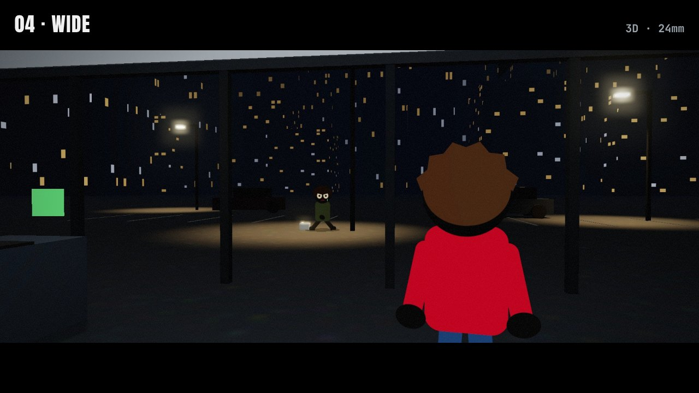

- **Shot:** Wide · deep focus · **Lens:** 24mm
- **Camera:** Slow lateral dolly left along the windows, keeping Sami small in the foreground and the man in the car park sharp.
- **Action:** Inside, bright. Through the glass, the man walks into the dark car park, drops the ice under a street lamp and falls to his knees. Sami watches, back to us.
- **Sound:** NARRATOR: "You notice the sleeve. You notice he's sweating in October." · "You count without meaning to."
- **Image prompt:** Wide shot from inside a bright empty supermarket looking out through tall front windows at a dark car park at night, a man kneeling under a sodium street lamp beside a dropped bag of ice, a teenage cashier in a red T-shirt (REF Sami) seen from behind in the foreground. Cinematic 3D animated film still, stylised cartoon characters with solid black skin, big round white eyes and simple bold clothes (match the character references), detailed realistic 3D environment, volumetric fog, moody cinematic lighting, anamorphic 2.39:1 frame, shallow depth of field, subtle film grain, no text, no logos.

### 5. Day 1 · Front windows — 0:34–0:42

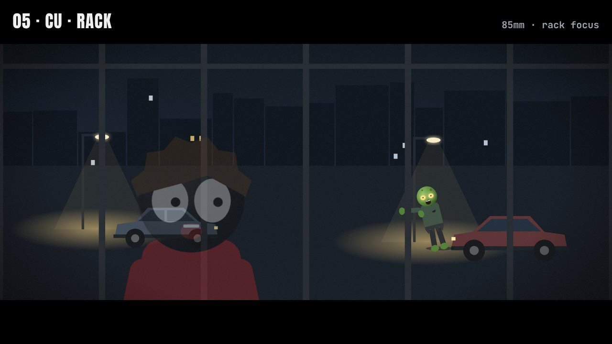

- **Shot:** CU · rack focus · **Lens:** 85mm
- **Camera:** Rack focus: from Sami's reflection in the glass to the man behind it, who stands up "wrong". Tiny push.
- **Action:** Sami's reflection floats on the glass. Behind it, in the car park, the man jerks upright. Yellow eyes.
- **Sound:** SFX: one wet howl through the glass; a dozen answer across the city. MUSIC: muzak warps and dies.
- **Image prompt:** Close-up of a teenage boy's faint reflection (REF Sami) on a dark shop window at night, and behind the glass in the car park a man standing with a twisted posture and glowing yellow eyes under a street lamp, rack focus. Cinematic 3D animated film still, stylised cartoon characters with solid black skin, big round white eyes and simple bold clothes (match the character references), detailed realistic 3D environment, volumetric fog, moody cinematic lighting, anamorphic 2.39:1 frame, shallow depth of field, subtle film grain, no text, no logos.

### 6. Day 1 · The city — 0:42–0:48

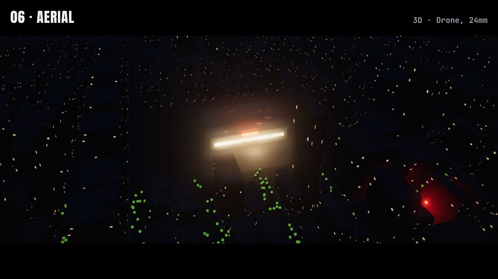

- **Shot:** AERIAL · establishing · **Lens:** Drone, 24mm
- **Camera:** High drone shot, slow forward glide and tilt down: the city in panic, one supermarket glowing in a dark car park, the first figures streaming toward its light.
- **Action:** Sirens pulse in the streets. Blocks go dark. The store is the brightest thing for a mile, and things are walking toward it.
- **Sound:** SFX: distant sirens, a helicopter, howls answering each other across blocks.
- **Image prompt:** High aerial drone shot of a dark city at night, streets with flashing police lights, a single brightly lit supermarket in a car park at the centre, hundreds of small green-headed zombie figures streaming along the streets toward it, fires in the distance, volumetric haze. Cinematic 3D animated film still, stylised cartoon characters with solid black skin, big round white eyes and simple bold clothes (match the character references), detailed realistic 3D environment, volumetric fog, moody cinematic lighting, anamorphic 2.39:1 frame, shallow depth of field, subtle film grain, no text, no logos.

### 7. Day 1 · Shop floor — 0:48–0:58

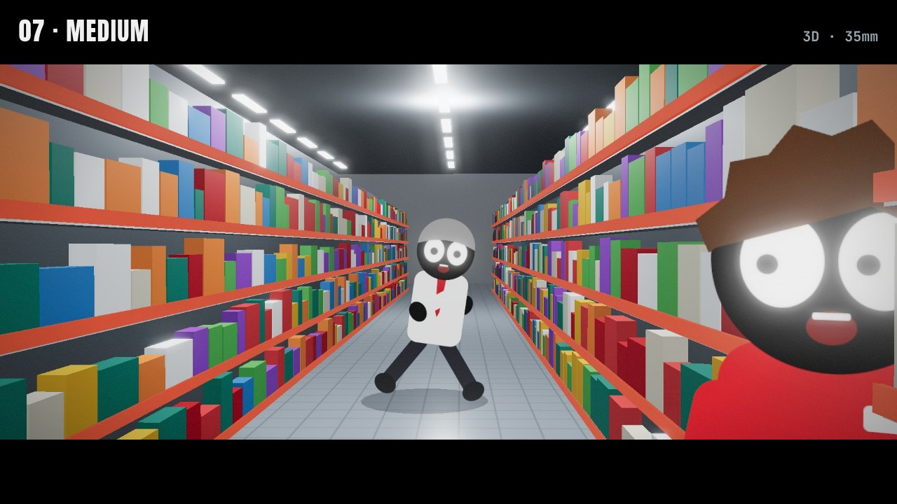

- **Shot:** Medium · Steadicam · **Lens:** 35mm
- **Camera:** Steadicam backs away fast in front of Mr. Davis as he runs down the aisle; Sami turns into the foreground.
- **Action:** Mr. Davis bursts out of the staff door, hand clamped on his neck, blood on his tie. "Shutter! Sami, the shutter!"
- **Sound:** MR. DAVIS: "Shutter! Sami, the shutter! The red button!"  NARRATOR: "...He came back with a bite on his neck."
- **Image prompt:** Steadicam medium shot in a bright supermarket aisle, a panicked store manager in a white shirt and red tie (REF Davis) running toward camera clutching his bleeding neck, a teenage stock boy in a red T-shirt (REF Sami) turning in the foreground. Cinematic 3D animated film still, stylised cartoon characters with solid black skin, big round white eyes and simple bold clothes (match the character references), detailed realistic 3D environment, volumetric fog, moody cinematic lighting, anamorphic 2.39:1 frame, shallow depth of field, subtle film grain, no text, no logos.

### 8. Day 1 · Front doors — 0:58–1:06

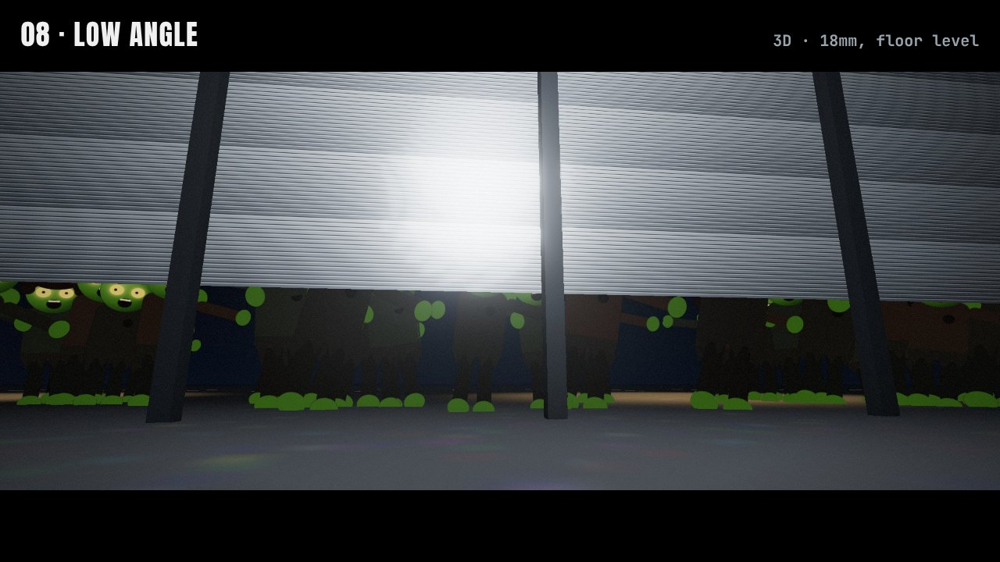

- **Shot:** Low angle · wide · **Lens:** 18mm, floor level
- **Camera:** Camera on the floor; the steel shutter crashes down toward the lens. Hard cut on impact.
- **Action:** The shutter roars down over the glass. Through the last gap: running legs, then green hands slam the glass as it hits the floor.
- **Sound:** SFX: shutter motor scream, a deafening metal crash, then hundreds of hands hammering.
- **Image prompt:** Floor-level low-angle wide shot inside a supermarket entrance as a steel roller shutter crashes down over the glass doors, through the narrow gap at the bottom zombie legs and green hands slamming the glass at night. Cinematic 3D animated film still, stylised cartoon characters with solid black skin, big round white eyes and simple bold clothes (match the character references), detailed realistic 3D environment, volumetric fog, moody cinematic lighting, anamorphic 2.39:1 frame, shallow depth of field, subtle film grain, no text, no logos.

### 9. Day 1 · Car park — 1:06–1:14

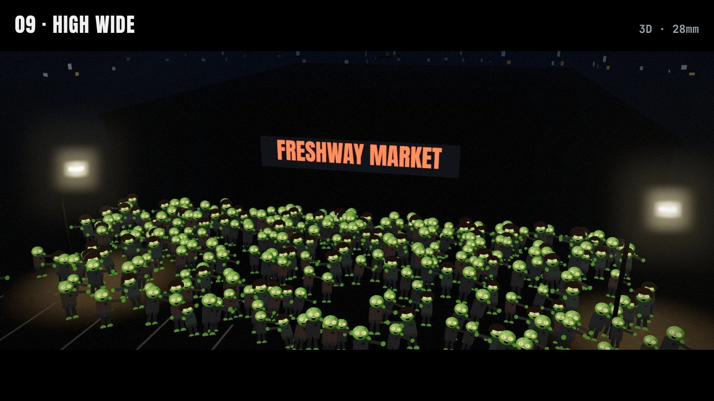

- **Shot:** High wide · crane · **Lens:** 28mm
- **Camera:** Crane rises over the car park as the horde floods the shutter; the sign flickers.
- **Action:** Outside: the horde piles against the shutter under the glowing FRESHWAY MARKET sign. Hands everywhere.
- **Sound:** NARRATOR: "Plan A was a normal night shift... Plan A just hit the floor."
- **Image prompt:** High crane shot of a supermarket front at night, steel shutters down, a large crowd of green-headed zombies piling against the shutters under a glowing red shop sign, abandoned cars and lamp posts in the car park, fog. Cinematic 3D animated film still, stylised cartoon characters with solid black skin, big round white eyes and simple bold clothes (match the character references), detailed realistic 3D environment, volumetric fog, moody cinematic lighting, anamorphic 2.39:1 frame, shallow depth of field, subtle film grain, no text, no logos.

### 10. Day 1 · Stockroom — 1:14–1:22

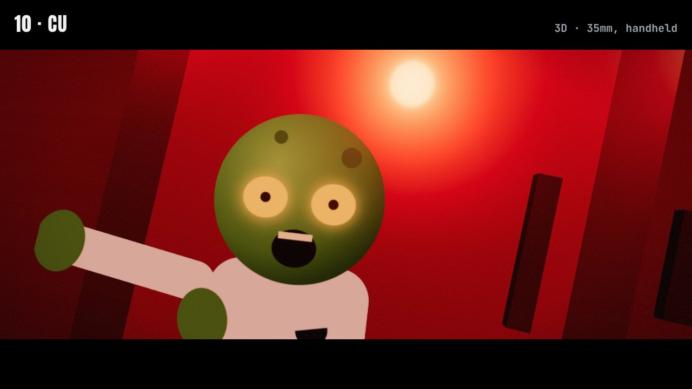

- **Shot:** CU · Dutch angle · **Lens:** 35mm, handheld
- **Camera:** Handheld, canted 15°. Snap zoom as his head jerks up.
- **Action:** Red emergency light. Mr. Davis slumped against the walk-in freezer. His head jerks up: glowing yellow eyes.
- **Sound:** SFX: a gurgling breath, then a howl right into the lens.
- **Image prompt:** Dutch-angle close-up in a red-lit supermarket stockroom, a store manager in a white shirt and red tie (REF Davis) turned zombie, green skin and glowing yellow eyes, head snapping up toward camera. Cinematic 3D animated film still, stylised cartoon characters with solid black skin, big round white eyes and simple bold clothes (match the character references), detailed realistic 3D environment, volumetric fog, moody cinematic lighting, anamorphic 2.39:1 frame, shallow depth of field, subtle film grain, no text, no logos.

### 11. Day 1 · Walk-in freezer — 1:22–1:34

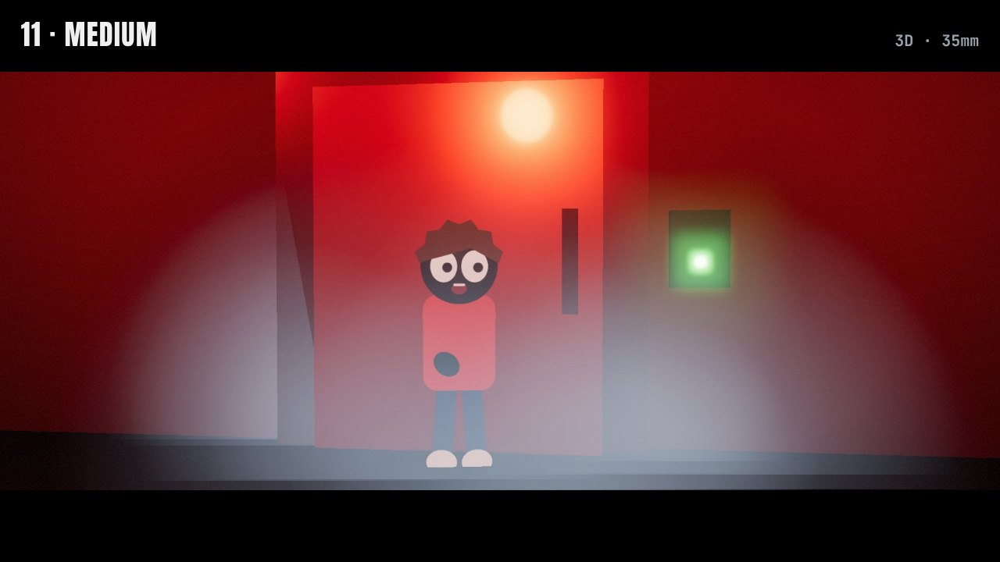

- **Shot:** Medium · **Lens:** 35mm
- **Camera:** Whip-pan from the chase onto the door as it slams; settle into a slow push on the lock's green light.
- **Action:** Sami bursts out of the freezer's second door and slams it. The electronic lock clicks green. Fists dent the steel from inside.
- **Sound:** NARRATOR: "Ten seconds. That's how long it takes..." · "The lock is electric. You don't think about that yet. You will."
- **Image prompt:** Medium shot of a teenage stock boy in a red T-shirt (REF Sami) pressed with his back against a steel walk-in freezer door, frost mist at his feet, a small electronic keypad lock glowing green beside the door, red stockroom light. Cinematic 3D animated film still, stylised cartoon characters with solid black skin, big round white eyes and simple bold clothes (match the character references), detailed realistic 3D environment, volumetric fog, moody cinematic lighting, anamorphic 2.39:1 frame, shallow depth of field, subtle film grain, no text, no logos.

### 12. Day 1 · Stockroom — 1:34–1:58

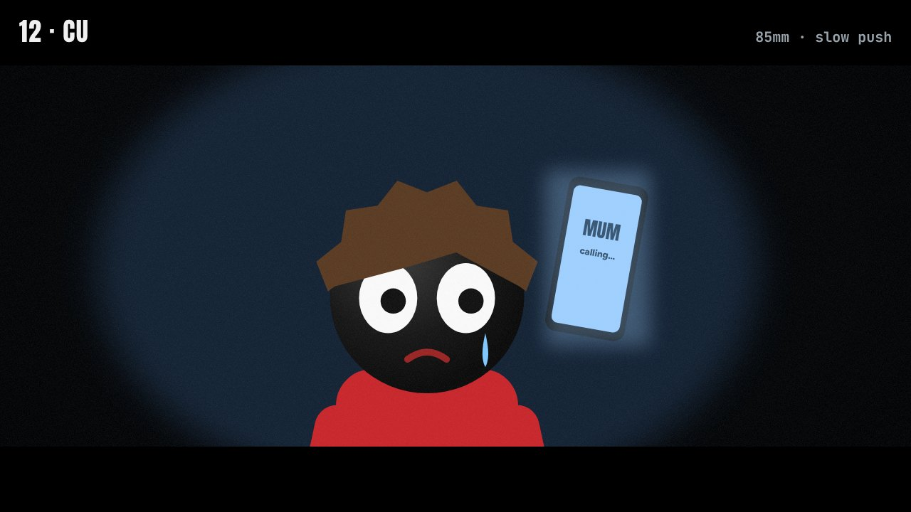

- **Shot:** CU · **Lens:** 85mm
- **Camera:** Very slow push-in; the phone is the only light.
- **Action:** Sami in the dark, phone to his ear. MUM on the screen. The call drops.
- **Sound:** MUM: "Sami? ...Stay where you are. I'm coming to get you..."  NARRATOR: "No bars. You try her forty times."
- **Image prompt:** Close-up of a teenage boy (REF Sami) in a dark stockroom lit only by the blue glow of a phone held to his ear, frightened eyes, tears welling. Cinematic 3D animated film still, stylised cartoon characters with solid black skin, big round white eyes and simple bold clothes (match the character references), detailed realistic 3D environment, volumetric fog, moody cinematic lighting, anamorphic 2.39:1 frame, shallow depth of field, subtle film grain, no text, no logos.

### 13. Day 1 · Chalkboard — 1:58–2:30

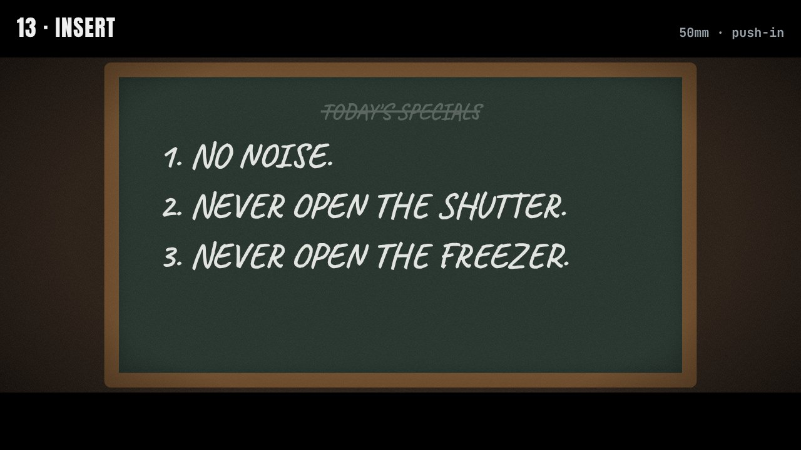

- **Shot:** Insert · **Lens:** 50mm
- **Camera:** Push-in as each rule is written; dust drifts through a shaft of emergency light.
- **Action:** Sami wipes TODAY'S SPECIALS and writes three rules in chalk.
- **Sound:** NARRATOR: "...Food is not what kills you in here. [beat] Noise is."  SFX: chalk scratch, then the muzak plug ripped out, sudden silence.
- **Image prompt:** Insert shot of a supermarket chalkboard specials sign, the old prices wiped off and three survival rules hand-written in white chalk, dim emergency light, dust in the air. Cinematic 3D animated film still, stylised cartoon characters with solid black skin, big round white eyes and simple bold clothes (match the character references), detailed realistic 3D environment, volumetric fog, moody cinematic lighting, anamorphic 2.39:1 frame, shallow depth of field, subtle film grain, no text, no logos.

### 14. Day 4 · Staff sink — 2:30–3:00

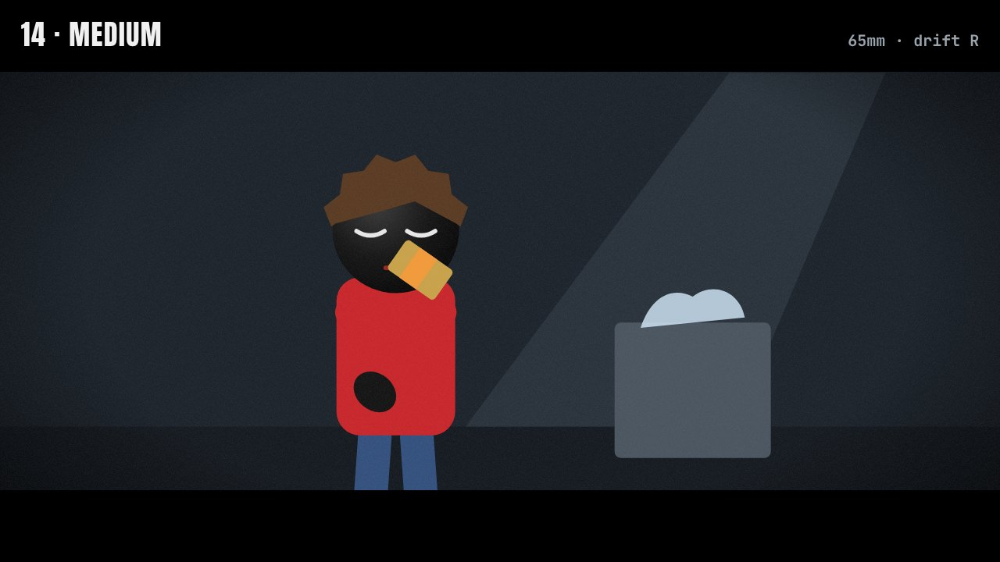

- **Shot:** Insert → Medium · **Lens:** 65mm
- **Camera:** Insert on the tap as it coughs dry; cut to a medium of Sami drinking from a can, slow drift right.
- **Action:** The tap spits and stops. Then: Sami drinks the juice from a can of peaches like champagne, ice bags melting in a bin beside him.
- **Sound:** NARRATOR: "Day four. The taps stop..." · "...You start drinking it out of the can like it's champagne."
- **Image prompt:** Medium shot of a teenage boy (REF Sami) in a dim supermarket staff room drinking juice straight from a tin can, a bin of melting bags of ice beside him, grey morning light from a high window. Cinematic 3D animated film still, stylised cartoon characters with solid black skin, big round white eyes and simple bold clothes (match the character references), detailed realistic 3D environment, volumetric fog, moody cinematic lighting, anamorphic 2.39:1 frame, shallow depth of field, subtle film grain, no text, no logos.

### 15. Days 4–6 · Montage — 3:00–3:10

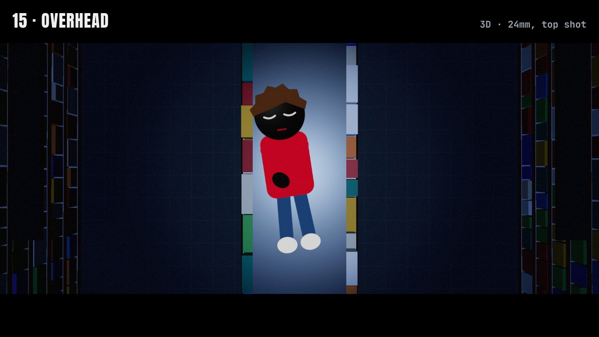

- **Shot:** Overhead · top-down · **Lens:** 24mm, top shot
- **Camera:** God's-eye view, slowly rotating as the camera rises.
- **Action:** Sami asleep on the top shelf of Aisle 12, curled between packs of paper towels, as far from the floor as he can get.
- **Sound:** [NO WORDS] MUSIC: lonely ticking piano.
- **Image prompt:** Top-down overhead shot of a teenage boy (REF Sami) asleep curled up on the top shelf of a supermarket aisle between rows of paper towel packs, dark store, cold moonlight from skylights. Cinematic 3D animated film still, stylised cartoon characters with solid black skin, big round white eyes and simple bold clothes (match the character references), detailed realistic 3D environment, volumetric fog, moody cinematic lighting, anamorphic 2.39:1 frame, shallow depth of field, subtle film grain, no text, no logos.

### 16. Days 4–6 · Montage — 3:10–3:22

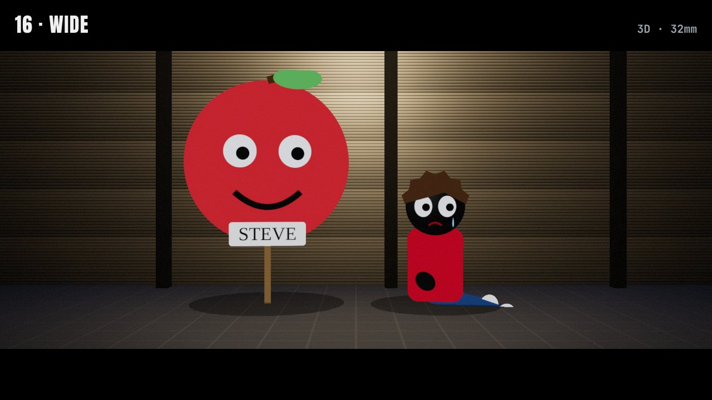

- **Shot:** Wide · symmetrical · **Lens:** 32mm
- **Camera:** Locked-off, perfectly centred. A quiet, sad joke.
- **Action:** Sami on the floor eating cold beans next to the store's cardboard mascot (a smiling apple), which now wears a name tag: STEVE. The shutter behind them.
- **Sound:** [NO WORDS] SFX: spoon on tin, faint scratching from the freezer far away.
- **Image prompt:** Symmetrical wide shot of a teenage boy (REF Sami) sitting on a supermarket floor eating beans from a tin next to a life-size cardboard mascot of a smiling apple wearing a handwritten name tag, closed steel shutters behind, dim light. Cinematic 3D animated film still, stylised cartoon characters with solid black skin, big round white eyes and simple bold clothes (match the character references), detailed realistic 3D environment, volumetric fog, moody cinematic lighting, anamorphic 2.39:1 frame, shallow depth of field, subtle film grain, no text, no logos.

### 17. Day 6 · Security office — 3:22–3:55

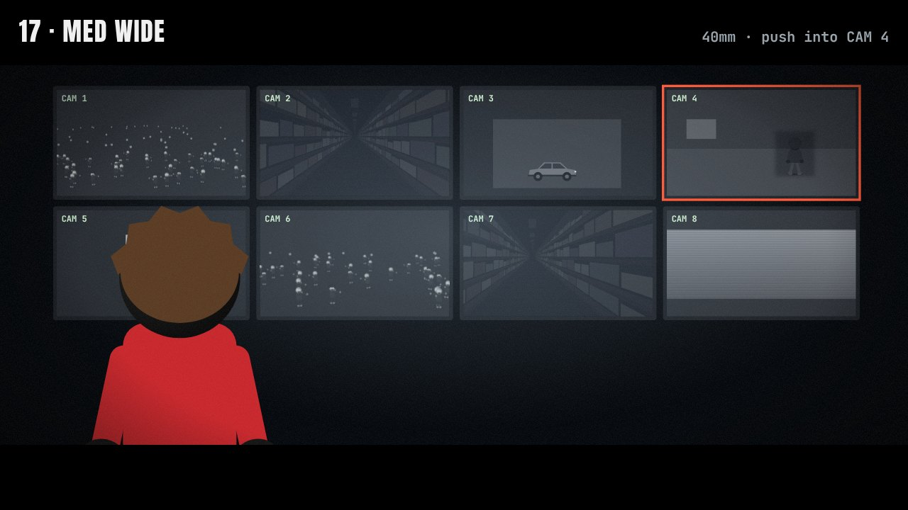

- **Shot:** Medium wide → insert · **Lens:** 40mm
- **Camera:** Slow push past Sami's shoulder into CAM 4; hold on the roof feed as the shadow crosses.
- **Action:** Eight security monitors. Car park full of still figures. On the roof camera, an upright shadow crosses, careful and quiet.
- **Sound:** NARRATOR: "At 2:13 a.m., something walks across the roof. Not the way they walk..."  SFX: monitor buzz.
- **Image prompt:** Medium wide shot of a dark security office, a wall of eight black-and-white CCTV monitors showing a car park full of zombies, aisles and a rooftop where a human shadow crosses, a teenage boy (REF Sami) silhouetted in front lit blue. Cinematic 3D animated film still, stylised cartoon characters with solid black skin, big round white eyes and simple bold clothes (match the character references), detailed realistic 3D environment, volumetric fog, moody cinematic lighting, anamorphic 2.39:1 frame, shallow depth of field, subtle film grain, no text, no logos.

### 18. Day 8 · Outside the shutter — 3:55–4:15

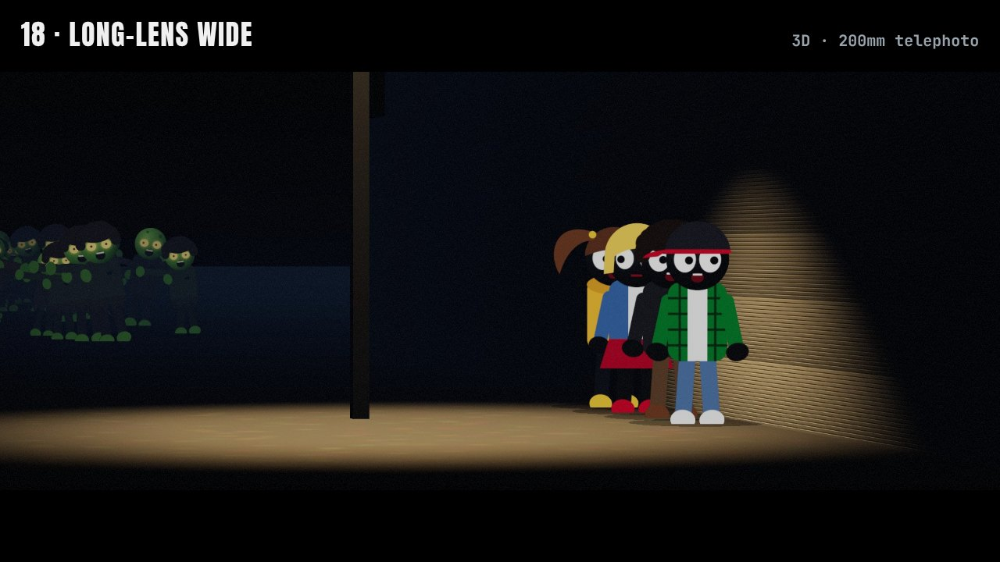

- **Shot:** Long-lens wide · **Lens:** 200mm telephoto
- **Camera:** Locked off; heat-haze compression makes the horde behind look right on top of the kids.
- **Action:** Four teenagers pressed against the shutter, knocking a pattern. Down the street, the horde turns their way like one animal.
- **Sound:** MAYA (O.S.): "Hello? Please. We've been on the roof next door for a week..."  RICO (O.S.): "Maya. They heard us."
- **Image prompt:** Telephoto compressed shot at night of four frightened teenagers (REF Maya, Zoe, Theo, Rico) pressed against a closed supermarket steel shutter, behind them far down the street a huge zombie horde turning toward them, foggy, sodium light. Cinematic 3D animated film still, stylised cartoon characters with solid black skin, big round white eyes and simple bold clothes (match the character references), detailed realistic 3D environment, volumetric fog, moody cinematic lighting, anamorphic 2.39:1 frame, shallow depth of field, subtle film grain, no text, no logos.

### 19. Day 8 · The gap — 4:15–4:35

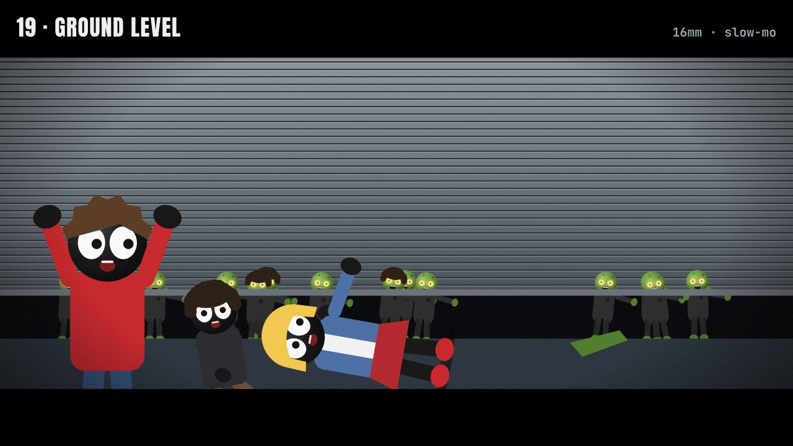

- **Shot:** Ground level · wide · **Lens:** 16mm, lens on the floor
- **Camera:** Camera on the floor inside. Bodies slide under the shutter straight at the lens, slow motion as the hand grabs Zoe's ankle.
- **Action:** Sami holds the shutter two feet up. Theo, Maya and Rico roll in. Zoe last: a green hand grabs her ankle, she kicks free, her arm scrapes the steel edge.
- **Sound:** MUSIC: heartbeat. SFX: bodies on tile, the shutter slams. ZOE: "Who are you?"  SAMI: "...Can I help you find anything?"
- **Image prompt:** Floor-level wide shot inside a supermarket at night, a steel shutter raised two feet, teenagers sliding underneath toward camera, a blonde girl in a denim jacket (REF Zoe) half through with a green zombie hand grabbing her ankle from outside, slow motion. Cinematic 3D animated film still, stylised cartoon characters with solid black skin, big round white eyes and simple bold clothes (match the character references), detailed realistic 3D environment, volumetric fog, moody cinematic lighting, anamorphic 2.39:1 frame, shallow depth of field, subtle film grain, no text, no logos.

### 20. Day 8 · Stockroom — 4:35–5:00

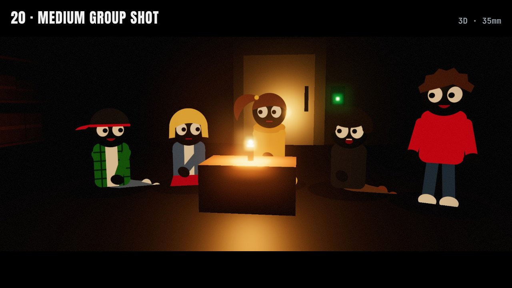

- **Shot:** Medium group shot · **Lens:** 35mm
- **Camera:** Slow arc (half-orbit) around the group by candlelight.
- **Action:** Five people in candlelight. Maya takes the peroxide off Zoe and cleans the cut with water and soap. Rico smiles. Theo clutches his speaker: "It's OFF!"
- **Sound:** MAYA: "Not that. ...Clean water, soap, and a lot of it."  ZOE: "Is she always like this?"  THEO: "It's off!"
- **Image prompt:** Warm candlelit medium group shot in a supermarket stockroom, five teenagers (REF Sami, Maya, Zoe, Theo, Rico) sitting on boxes, the girl in a yellow hoodie cleaning a scrape on the blonde girl's arm with bottled water, a boy hugging a small speaker. Cinematic 3D animated film still, stylised cartoon characters with solid black skin, big round white eyes and simple bold clothes (match the character references), detailed realistic 3D environment, volumetric fog, moody cinematic lighting, anamorphic 2.39:1 frame, shallow depth of field, subtle film grain, no text, no logos.

### 21. Day 9 · Blackout — 5:00–5:15

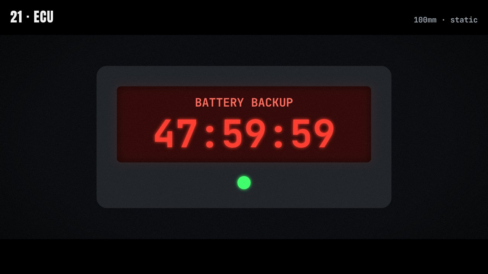

- **Shot:** ECU insert · **Lens:** 100mm macro
- **Camera:** Static, the digits tick. Shallow focus; the freezer handle soft behind.
- **Action:** The lights die. The freezer lock switches to battery: 48:00:00 → 47:59:59.
- **Sound:** SFX: every hum dies at once, then one tiny digital beep per second. NARRATOR: "Forty-eight hours. Then the door opens..."
- **Image prompt:** Extreme close-up of a small red LCD display on an electronic freezer lock reading a countdown, dark stockroom, frost on the steel around it, shallow depth of field. Cinematic 3D animated film still, stylised cartoon characters with solid black skin, big round white eyes and simple bold clothes (match the character references), detailed realistic 3D environment, volumetric fog, moody cinematic lighting, anamorphic 2.39:1 frame, shallow depth of field, subtle film grain, no text, no logos.

### 22. Day 9 · Stockroom — 5:15–5:30

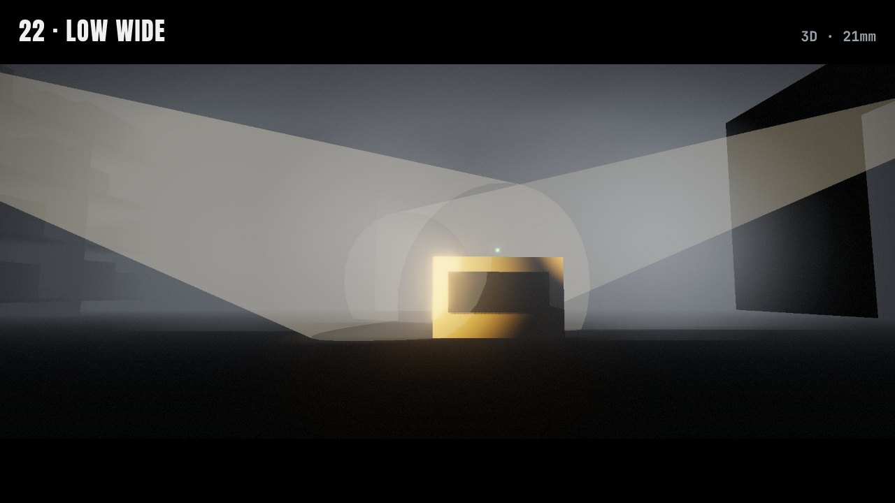

- **Shot:** Low wide · **Lens:** 21mm
- **Camera:** Low dolly toward the running generator; torch beams cut through the exhaust haze building in the room.
- **Action:** A petrol generator roars inside the closed stockroom, cable running to the freezer lock. Haze hangs in the torch beams.
- **Sound:** RICO: "Outside's not an option." NARRATOR: "It's the most reasonable mistake you've ever made."  SFX: muffled generator drone.
- **Image prompt:** Low-angle wide shot of a portable petrol generator running inside a closed dark supermarket stockroom, grey exhaust haze hanging in the beams of flashlights, a cable running to a freezer door, teenagers in silhouette. Cinematic 3D animated film still, stylised cartoon characters with solid black skin, big round white eyes and simple bold clothes (match the character references), detailed realistic 3D environment, volumetric fog, moody cinematic lighting, anamorphic 2.39:1 frame, shallow depth of field, subtle film grain, no text, no logos.

### 23. Day 10 · The air — 5:30–6:05

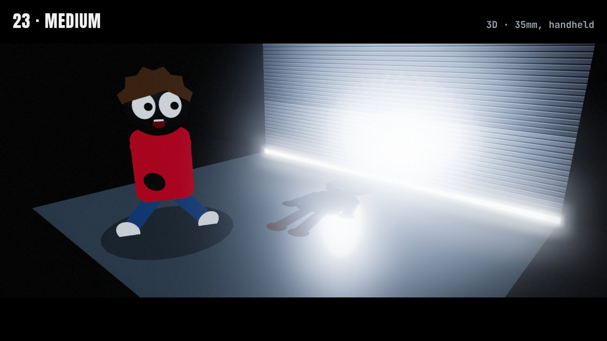

- **Shot:** Medium · handheld · **Lens:** 35mm, handheld
- **Camera:** Handheld, unsteady, slightly out of focus (we feel the CO). Snaps sharp when Theo breathes.
- **Action:** Theo collapses. Sami drags him to the dock door and holds his face to the crack of grey morning light under it.
- **Sound:** MAYA: "It's not the food. It's the air." NARRATOR: "Carbon monoxide. No colour. No smell..." [NO WORDS 5s: breathing]  THEO: "...Did I miss anything?"
- **Image prompt:** Handheld medium shot on a stockroom floor, a teenage boy in a red T-shirt (REF Sami) holding his unconscious curly-haired friend (REF Theo) so his face is at the narrow strip of daylight under a roll-up loading dock door, dust in the light beam. Cinematic 3D animated film still, stylised cartoon characters with solid black skin, big round white eyes and simple bold clothes (match the character references), detailed realistic 3D environment, volumetric fog, moody cinematic lighting, anamorphic 2.39:1 frame, shallow depth of field, subtle film grain, no text, no logos.

### 24. Day 11 · The countdown — 6:05–6:15

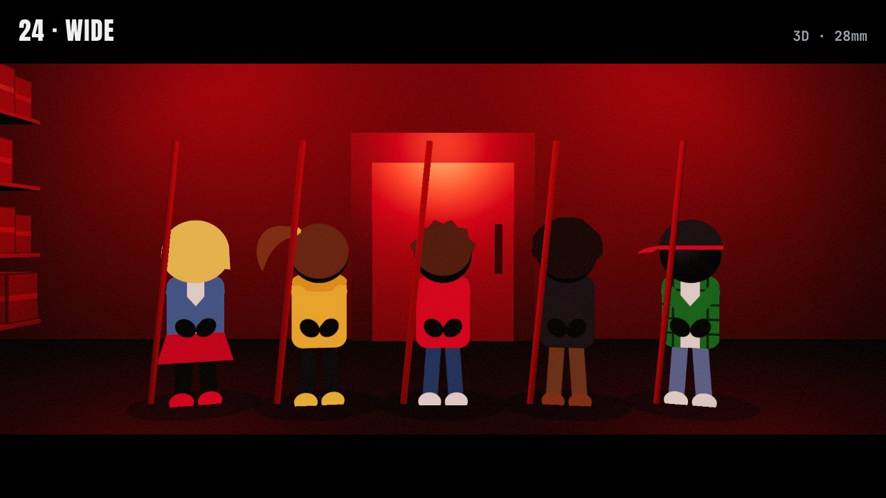

- **Shot:** Wide · symmetrical · **Lens:** 28mm
- **Camera:** Locked-off and dead centre, then a very slow push as the display hits zero.
- **Action:** All five in a line with mop-handle spears, backs to us, facing the freezer door. The display: 00:00:03… 2… 1…
- **Sound:** SFX: beep… beep… beep… CLICK. Silence. A long, slow creak.
- **Image prompt:** Symmetrical wide shot from behind five teenagers in a line (REF Sami, Maya, Zoe, Theo, Rico) holding makeshift spears made from mop handles, facing a steel walk-in freezer door in a red-lit stockroom, a red countdown display beside the door reading one second. Cinematic 3D animated film still, stylised cartoon characters with solid black skin, big round white eyes and simple bold clothes (match the character references), detailed realistic 3D environment, volumetric fog, moody cinematic lighting, anamorphic 2.39:1 frame, shallow depth of field, subtle film grain, no text, no logos.

### 25. Day 11 · The freezer opens — 6:15–6:25

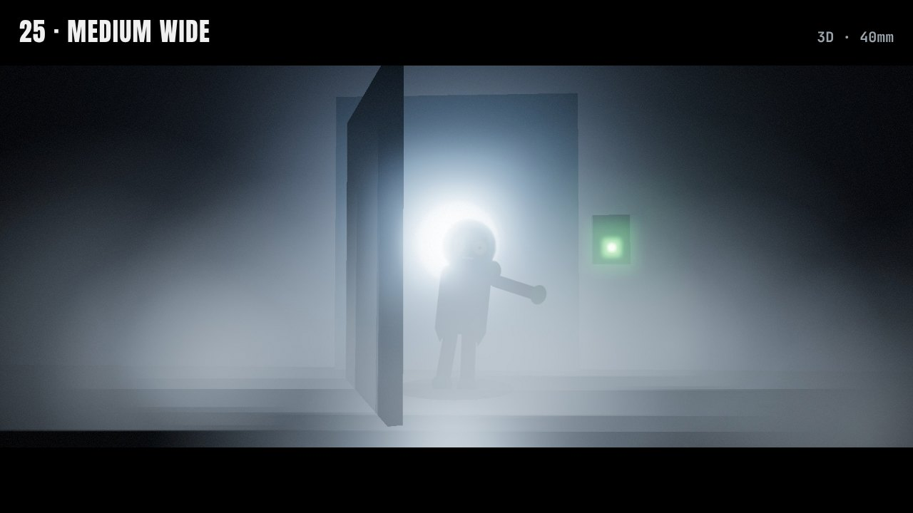

- **Shot:** Medium wide · backlit · **Lens:** 40mm
- **Camera:** Static as the mist rolls toward the lens; the figure walks out of the white into silhouette.
- **Action:** The door swings open. Cold white light and mist pour across the floor. Mr. Davis walks out of it, frosted, eyes glowing, and howls.
- **Sound:** [NO WORDS 6s] Then a howl. MUSIC: a single sub hit.
- **Image prompt:** Medium wide shot of an open walk-in freezer doorway blazing with cold white light, thick mist pouring out across a dark stockroom floor, the silhouette of a zombie store manager in a tie (REF Davis) with glowing yellow eyes stepping out of the mist. Cinematic 3D animated film still, stylised cartoon characters with solid black skin, big round white eyes and simple bold clothes (match the character references), detailed realistic 3D environment, volumetric fog, moody cinematic lighting, anamorphic 2.39:1 frame, shallow depth of field, subtle film grain, no text, no logos.

### 26. Day 11 · The bite — 6:25–6:40

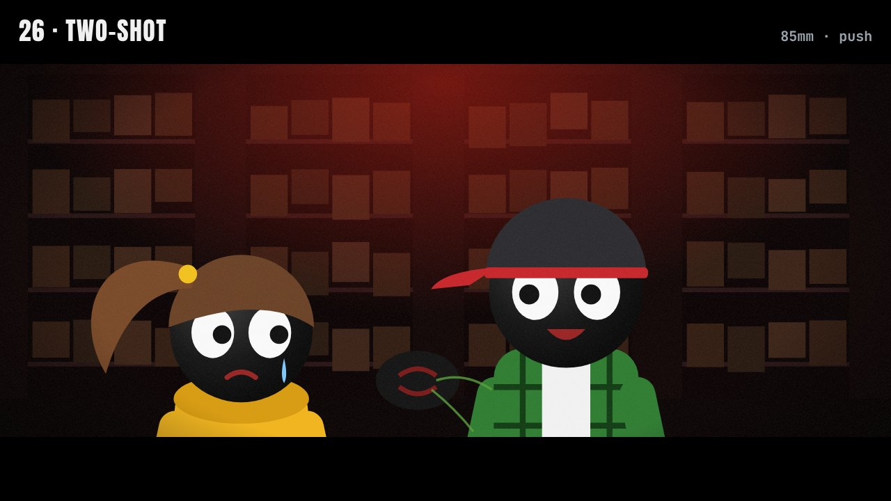

- **Shot:** Two-shot CU · **Lens:** 85mm
- **Camera:** Slow push from the hand up to Rico's calm face.
- **Action:** Rico on the floor holding his hand: a bite across the back of it. Maya kneels, shaking. He smiles too calmly.
- **Sound:** MAYA: "Let me see it." RICO: "It's a hand. Hands are slow, right?" NARRATOR: "Hours, not seconds. That's the good news..."
- **Image prompt:** Close two-shot on a stockroom floor, a teenage boy in a backwards cap and green flannel shirt (REF Rico) calmly looking at a bite on the back of his hand, a girl in a yellow hoodie (REF Maya) kneeling in front of him in tears, dim red emergency light. Cinematic 3D animated film still, stylised cartoon characters with solid black skin, big round white eyes and simple bold clothes (match the character references), detailed realistic 3D environment, volumetric fog, moody cinematic lighting, anamorphic 2.39:1 frame, shallow depth of field, subtle film grain, no text, no logos.

### 27. Day 12 · The recording — 6:40–7:00

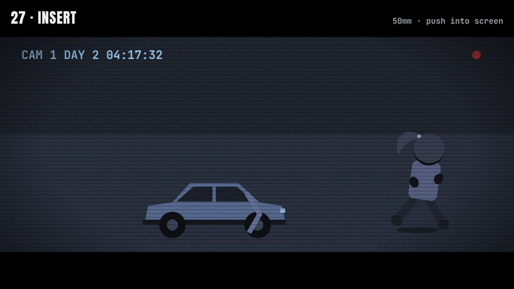

- **Shot:** Insert · screen · **Lens:** 50mm
- **Camera:** Push into the monitor until the scan lines fill the frame; the footage freezes.
- **Action:** Grainy CCTV, DAY 2 04:17: a small blue car pulls in; a woman runs toward the store and out of frame. The car door stays open. Live feed: the same car, a pink scarf caught in the door.
- **Sound:** NARRATOR: "She came. She said she would, and she came..." · "She runs out of frame. And she never runs back into it."
- **Image prompt:** Grainy black-and-white security camera footage of a supermarket car park at night, a small car with its driver door left open and a scarf caught in it, a woman running out of frame, timestamp overlay. Cinematic 3D animated film still, stylised cartoon characters with solid black skin, big round white eyes and simple bold clothes (match the character references), detailed realistic 3D environment, volumetric fog, moody cinematic lighting, anamorphic 2.39:1 frame, shallow depth of field, subtle film grain, no text, no logos.

### 28. Day 12 · Grief — 7:00–7:10

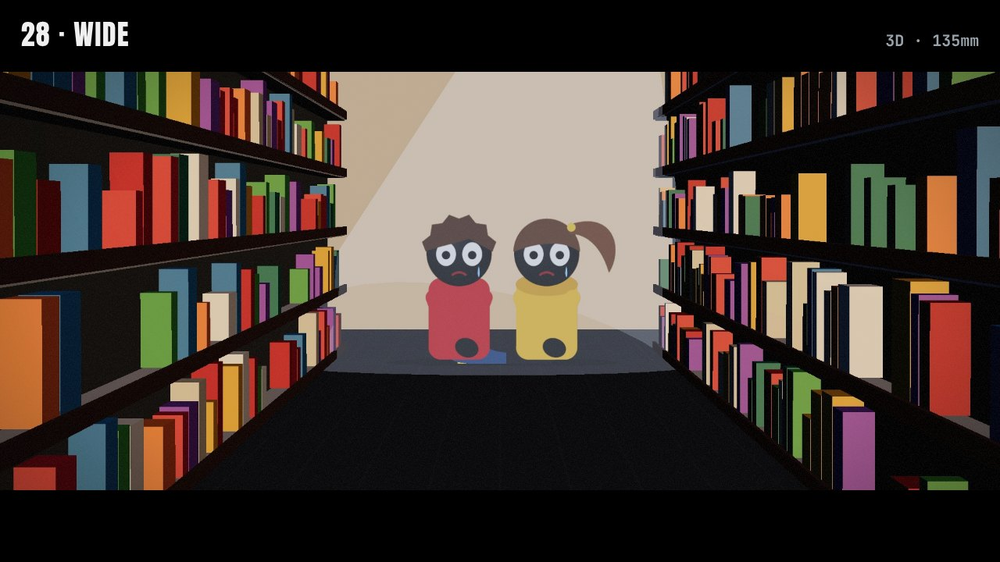

- **Shot:** Wide · low key · **Lens:** 135mm
- **Camera:** Long lens from the far end of an aisle; static. Let it sit.
- **Action:** Sami slides down the wall. Maya sits next to him and doesn't say anything. She just stays.
- **Sound:** [NO WORDS] MUSIC: Sami's piano theme, one hand only.
- **Image prompt:** Long-lens wide shot down a dark supermarket aisle, at the far end two small figures sitting on the floor against the wall, a boy in a red T-shirt (REF Sami) and a girl in a yellow hoodie (REF Maya), a single shaft of grey dawn light. Cinematic 3D animated film still, stylised cartoon characters with solid black skin, big round white eyes and simple bold clothes (match the character references), detailed realistic 3D environment, volumetric fog, moody cinematic lighting, anamorphic 2.39:1 frame, shallow depth of field, subtle film grain, no text, no logos.

### 29. Day 13 · The plan — 7:10–7:40

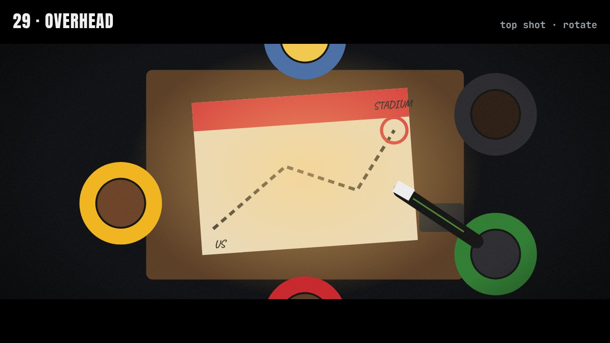

- **Shot:** Overhead · **Lens:** 28mm, top shot
- **Camera:** Top-down, slowly rotating as hands point at the map.
- **Action:** Around a cereal-box map of the city: a crackling radio, a torch, five pairs of hands. Rico's hand is wrapped; green veins up his arm.
- **Sound:** RADIO: "...Harlow Stadium roof. Helicopters leave at noon, day fourteen." ZOE: "Three miles..." RICO: "They go where the noise is. So we give them noise."
- **Image prompt:** Top-down overhead shot of five teenagers around a stockroom table, a hand-drawn city map on a flattened cereal box, a battery radio, a flashlight, hands pointing at a stadium on the map, one boy's bandaged hand with green veins. Cinematic 3D animated film still, stylised cartoon characters with solid black skin, big round white eyes and simple bold clothes (match the character references), detailed realistic 3D environment, volumetric fog, moody cinematic lighting, anamorphic 2.39:1 frame, shallow depth of field, subtle film grain, no text, no logos.

### 30. Day 14 · THE HORDE (key aerial) — 7:40–7:55

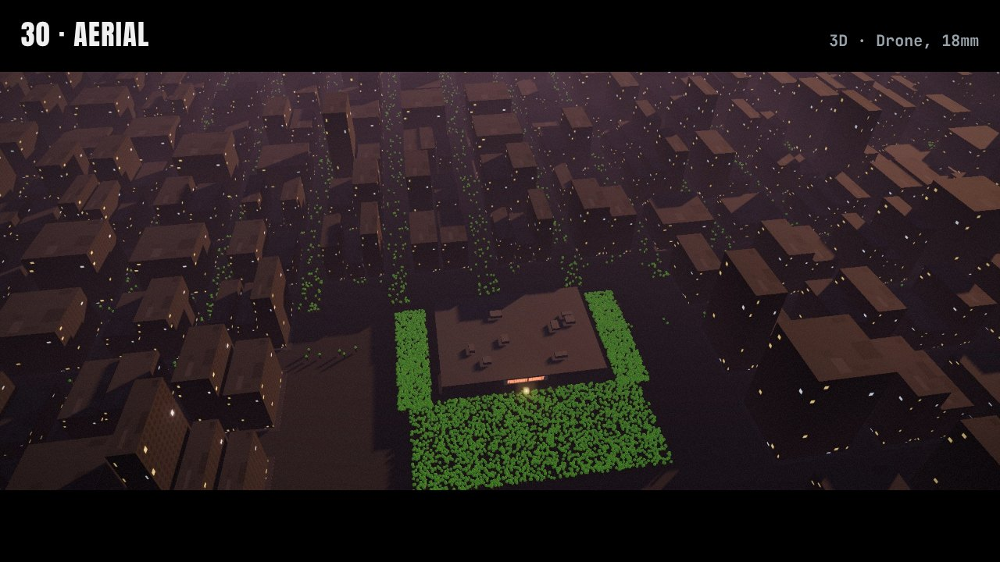

- **Shot:** AERIAL · reveal · **Lens:** Drone, 18mm
- **Camera:** Drone launches from the store roof and rises straight up and back (a "pedestal + pull-out"), revealing thousands of zombies flowing around the building toward the music at the front. Dawn breaks on the horizon.
- **Action:** Theo's speaker blasts pop music from the front shutter. From above: a river of green heads pours around both sides of the store, out of every street, into the car park.
- **Sound:** MUSIC: Theo's cheerful pop song, tinny from above, under a rising orchestral drone. SFX: thousands of howls, feet like rain.
- **Image prompt:** Epic high aerial drone shot at dawn over a supermarket in a ruined city, thousands upon thousands of green-headed zombies flowing like a river through every street and around both sides of the building toward the front car park, smoke from distant fires, first golden light on the horizon, volumetric haze. Cinematic 3D animated film still, stylised cartoon characters with solid black skin, big round white eyes and simple bold clothes (match the character references), detailed realistic 3D environment, volumetric fog, moody cinematic lighting, anamorphic 2.39:1 frame, shallow depth of field, subtle film grain, no text, no logos.

### 31. Day 14 · Loading dock — 7:55–8:10

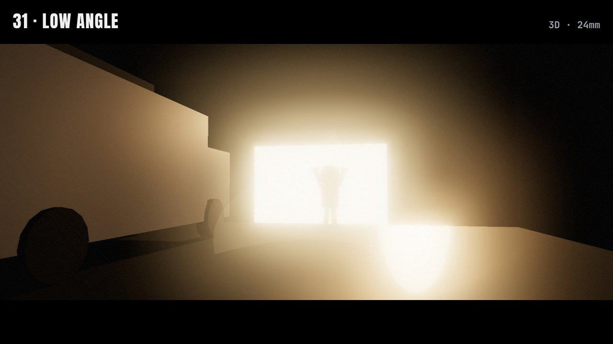

- **Shot:** Low angle · backlit · **Lens:** 24mm
- **Camera:** Low tracking shot alongside the van; the dock door rises and blinding dawn light floods the lens (flare).
- **Action:** Rico hauls the chain, the roll-up door rising, light pouring in around his silhouette. The van's engine roars. "Go. Go!"
- **Sound:** RICO: "Go. GO!"  SFX: chain rattle, engine, the pop song distant at the front.
- **Image prompt:** Low-angle backlit shot inside a loading dock at dawn, a teenage boy in a backwards cap and green flannel (REF Rico) hauling a chain to raise a roll-up door, blinding golden light and lens flare pouring in, a white delivery van in the foreground. Cinematic 3D animated film still, stylised cartoon characters with solid black skin, big round white eyes and simple bold clothes (match the character references), detailed realistic 3D environment, volumetric fog, moody cinematic lighting, anamorphic 2.39:1 frame, shallow depth of field, subtle film grain, no text, no logos.

### 32. Day 14 · The mirror — 8:10–8:20

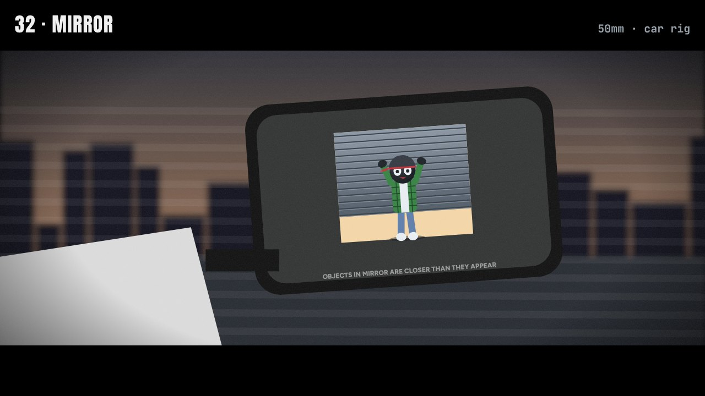

- **Shot:** Insert · mirror shot · **Lens:** 50mm
- **Camera:** Camera rides on the van; Rico is framed in the wing mirror, shrinking, as the door comes down between them.
- **Action:** In the side mirror: Rico pulling the chain back down, one hand raised in goodbye, until the door closes.
- **Sound:** MUSIC: Rico's goodbye, slow broken piano. SFX: the door hits the ground, far behind.
- **Image prompt:** Close shot of a delivery van's side mirror while driving away, in the mirror a small figure of a boy in a green flannel shirt (REF Rico) raising one hand goodbye as a loading dock door closes, motion-blurred street rushing past outside. Cinematic 3D animated film still, stylised cartoon characters with solid black skin, big round white eyes and simple bold clothes (match the character references), detailed realistic 3D environment, volumetric fog, moody cinematic lighting, anamorphic 2.39:1 frame, shallow depth of field, subtle film grain, no text, no logos.

### 33. Day 14 · The city — 8:20–8:40

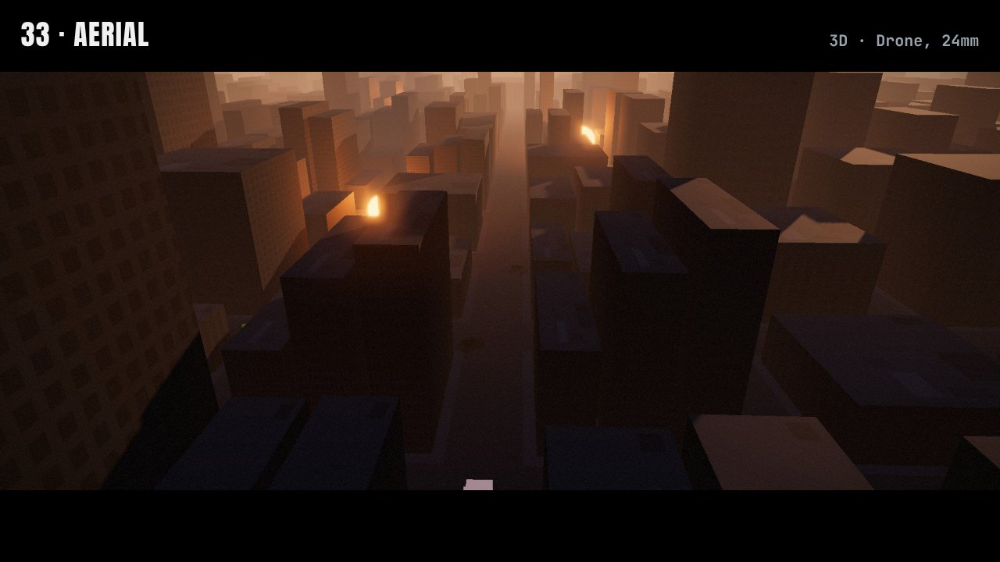

- **Shot:** AERIAL · chase · **Lens:** Drone, 24mm
- **Camera:** Fast drone chase from behind and above the van, banking left as it weaves between wrecks; the stadium and helicopter rise into frame.
- **Action:** A small white van weaves through an empty, burning city. Ahead, on the stadium roof, a helicopter waits, blades turning.
- **Sound:** [NO WORDS] MUSIC: the full theme, big, sad and hopeful.
- **Image prompt:** Fast aerial drone chase shot following a small white delivery van speeding through an empty burning city at sunrise, wrecked cars, smoke columns, a stadium ahead with a helicopter on its roof, golden light. Cinematic 3D animated film still, stylised cartoon characters with solid black skin, big round white eyes and simple bold clothes (match the character references), detailed realistic 3D environment, volumetric fog, moody cinematic lighting, anamorphic 2.39:1 frame, shallow depth of field, subtle film grain, no text, no logos.

### 34. Day 14 · The voicemail — 8:40–9:00

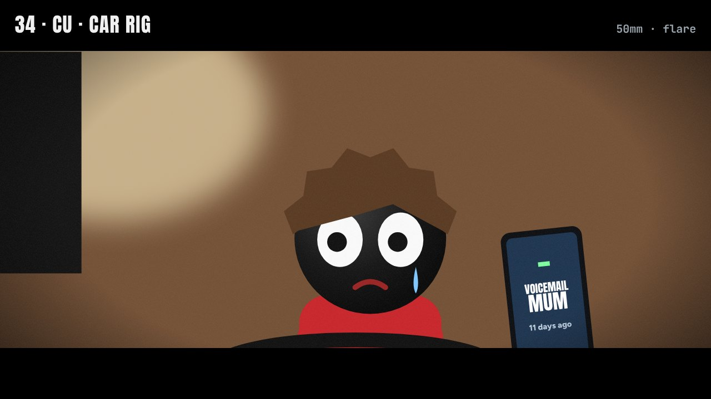

- **Shot:** CU · car rig · **Lens:** 50mm
- **Camera:** Car-mounted camera on the dashboard looking back at Sami; sunrise flares through the windscreen as he laughs and cries.
- **Action:** Sami driving, eyes red. His phone on the dash: one bar, VOICEMAIL — MUM. He plays it. He laughs and cries at once and puts his foot down.
- **Sound:** MUM: "...I'm at the stadium. I'm safe. Come to me, baby." NARRATOR: "Day fourteen. Eleven fifty-two a.m. ...somebody waiting for you."
- **Image prompt:** Dashboard-mounted close-up of a teenage boy in a red T-shirt (REF Sami) driving a van at sunrise, crying and laughing at once, a phone on the dashboard showing a voicemail notification, golden light flaring through the windscreen. Cinematic 3D animated film still, stylised cartoon characters with solid black skin, big round white eyes and simple bold clothes (match the character references), detailed realistic 3D environment, volumetric fog, moody cinematic lighting, anamorphic 2.39:1 frame, shallow depth of field, subtle film grain, no text, no logos.

### 35. End card — 9:00–9:10

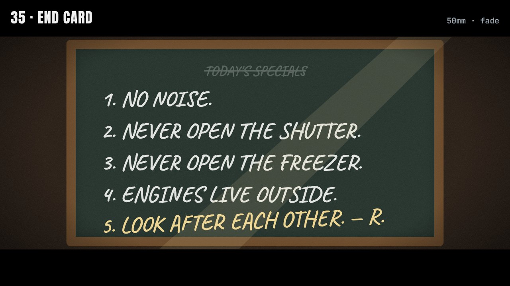

- **Shot:** Insert · **Lens:** 50mm
- **Camera:** Static, dust floating in a sunbeam. Slow fade to black.
- **Action:** The empty store. The chalkboard of rules. A fifth line in someone else's handwriting: 5. LOOK AFTER EACH OTHER. — R.
- **Sound:** SFX: far away, Theo's pop song still playing at the front. Cut to black.
- **Image prompt:** Insert shot of a supermarket chalkboard in an empty abandoned store lit by a beam of morning sunlight with floating dust, four survival rules in chalk and a fifth line in different handwriting at the bottom. Cinematic 3D animated film still, stylised cartoon characters with solid black skin, big round white eyes and simple bold clothes (match the character references), detailed realistic 3D environment, volumetric fog, moody cinematic lighting, anamorphic 2.39:1 frame, shallow depth of field, subtle film grain, no text, no logos.

